

  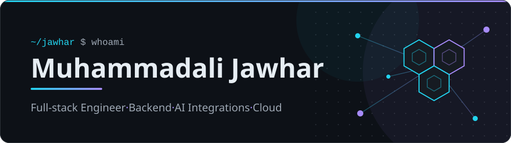

  

  <b>Full-stack engineer</b> · backend APIs · AI integrations · Kubernetes &amp; cloud

I build backend services and full-stack applications with Python and TypeScript, from API design to the React frontends on top.
I enjoy integrating AI into real products and running them reliably on Kubernetes with Helm and GitOps.

   

[LinkedIn](https://linkedin.com/in/muhammadali-jawhar-22a562228) · [LeetCode](https://leetcode.com/jauharp02)

## Technologies

**Languages**

 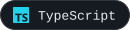 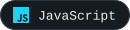 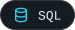  

**Frontend**

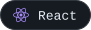 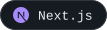 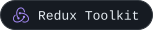  

**Backend**

    

**Data**

    

**AI integrations**

    

**Cloud and platform**

  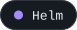    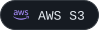

<b>Secondary tools</b>

      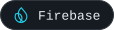   

<b>UI libraries</b>

     

<b>Authentication</b>

 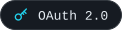    

<b>Observability and testing</b>

    

<b>Payment integrations</b>

 

## Activity

  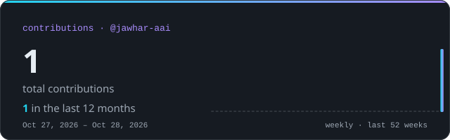

  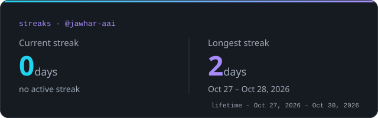

  <picture>
    <source media="(prefers-color-scheme: dark)" srcset="assets/generated/snake-dark.svg" />
    
  </picture>

  

Contribution data comes from this account's public GitHub calendar and refreshes daily via GitHub Actions.

